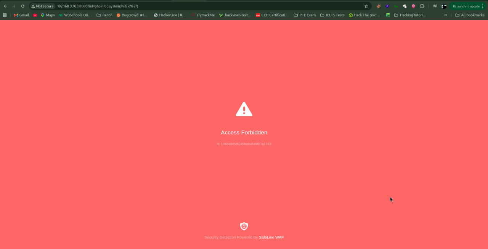
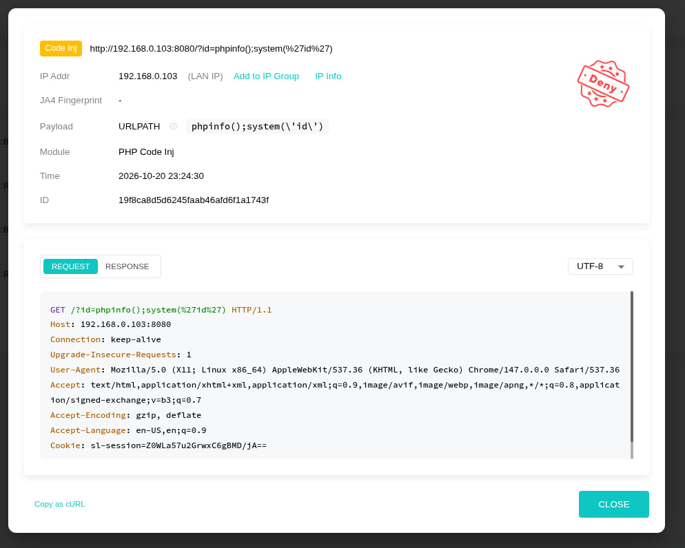
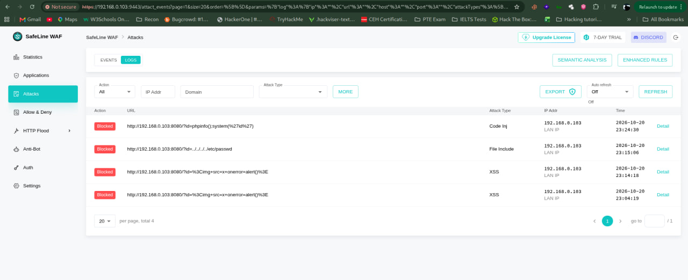
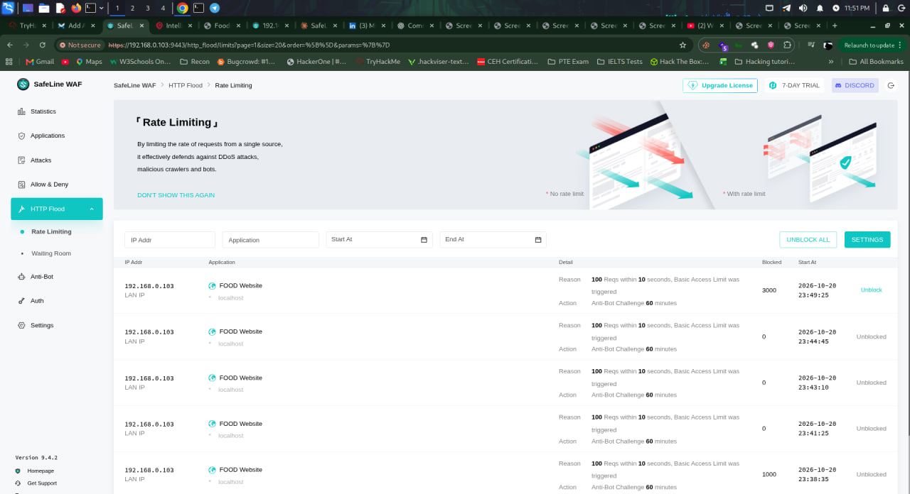
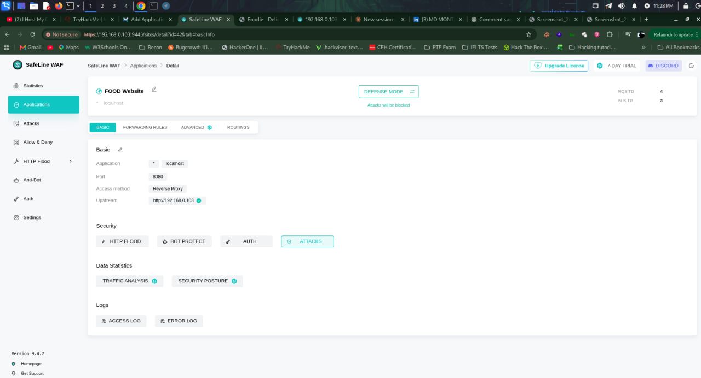
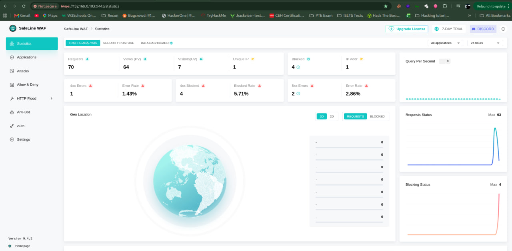

# Web Application Firewall Home Lab using SafeLine WAF

A hands-on home lab where I deployed **SafeLine WAF** as a reverse proxy in front of a vulnerable "Food Website", then attacked it myself to verify the defenses (Red Team + Blue Team perspective).

> All testing was done on my own isolated lab network. Do not run these tests against systems you do not own or have permission to test.

## Overview

| Item | Detail |
|---|---|
| WAF | SafeLine WAF v9.4.2 |
| Protected app | "FOOD Website" (upstream `http://192.168.0.103`) |
| Listening port | 8080 |
| Access method | Reverse Proxy |
| Mode | Defense Mode (attacks are blocked) |
| WAF console | `https://<waf-ip>:9443` |

## Architecture

```
Attacker / Browser  -->  SafeLine WAF (:8080, Reverse Proxy)  -->  Food Website (upstream)
                                |
                                +--> Attack logs, statistics, rate limiting
```

## Setup

1. Install SafeLine WAF by following the official documentation.
2. Open the management console on port `9443` and create an admin account.
3. **Applications → Add Application**
   - Domain: `*` / localhost
   - Port: `8080`
   - Access method: Reverse Proxy
   - Upstream: the Food Website server
4. Turn on **Defense Mode** so detected attacks are blocked, not only logged.
5. **HTTP Flood → Rate Limiting**: 100 requests within 10 seconds per IP triggers an Anti-Bot Challenge for 60 minutes.

## Attack Simulations & Results

| # | Attack | Test request (query string) | Detection module | Result |
|---|---|---|---|---|
| 1 | Cross-Site Scripting (XSS) | `?id=` | XSS | Blocked |
| 2 | Local File Inclusion / Path Traversal | `?id=../../../../etc/passwd` | File Include | Blocked |
| 3 | PHP Code Injection | `?id=phpinfo();system('id')` | PHP Code Inj | Blocked |
| 4 | HTTP Flood | request flood from a single IP | Rate Limiting | Challenged for 60 min, then manually unblocked |

Blocked requests returned a **403 Access Forbidden** page with a unique event ID, and each event was logged with attack type, source IP, URL, payload location and timestamp.

### HTTP flood test

```bash
# ApacheBench
ab -n 500 -c 20 http://<waf-ip>:8080/

# or a simple curl loop
for i in {1..200}; do curl -s -o /dev/null -w "%{http_code}\n" http://<waf-ip>:8080/; done
```

Once the threshold was crossed, SafeLine challenged the source IP and listed it under **HTTP Flood → Rate Limiting**, where it can be unblocked.

## Log & Incident Analysis

For every event in **Attacks → Logs → Detail** I reviewed:

- Attack type and detection module (e.g. PHP Code Injection)
- Payload and where it was found (URL path)
- Source IP, timestamp and event ID
- The full raw HTTP request (headers, user-agent, cookies)
- "Copy as cURL" to reproduce the request

## Screenshots

| | |
|---|---|
|  |  |
|  |  |
|  |  |

## What I Learned

- How a reverse-proxy WAF sits in front of an application and inspects every request
- How common web attacks (XSS, LFI, code injection) appear in real logs
- How rate limiting mitigates floods and abusive bots
- Reading WAF logs and validating defenses by attacking my own lab

## Next Steps

- Custom rules and Allow/Deny lists
- Set the rate-limit action to hard Block and compare with Challenge
- WAF bypass testing and false-positive tuning
- Anti-Bot and Auth protection

## Tools

SafeLine WAF, Reverse Proxy, ApacheBench / curl, Linux

## Author

**MD Montashir Mobine Rifat**
